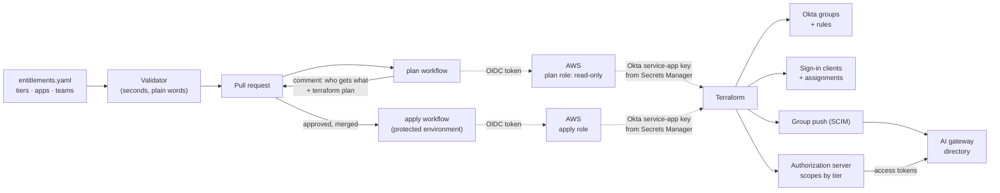

# ai-entitlements-terraform

**Who may use which AI tool, as code.** One small data file becomes Okta groups, group
rules, app assignments and token policies. An access change is a pull request with the
plan attached, applied by a pipeline that holds no static cloud key.

> **Status:** complete and tested against mock providers. **Nothing has been applied to
> a real Okta organisation, AWS account or Google project.** "What's real vs. mocked"
> below says what that does and doesn't prove.

## The problem

Access to AI tools is decided in the identity provider's admin console: someone creates a
group, adds people, assigns an app. Then:

- **Nobody reviewed it.** The change was a click.
- **Nobody can say why.** "Why does this person have access?" is answered from memory.
- **It drifts.** The console and whatever document describes it stop agreeing.
- **Movers and leavers need a ticket,** and tickets are forgotten.
- **Privileged groups grow quietly.** One click adds an approver.
- **The automation that could fix this holds an admin API token** that never expires.

## What it does

The whole of who-gets-what is [`entitlements/entitlements.yaml`](entitlements/entitlements.yaml):

```yaml
tiers:
  standard:
    rank: 2
    scopes: [gateway.use, tools.use]
    apps: [ai-cli, mcp-atlassian]

teams:
  trading-desk:
    tier: standard
    rule: 'user.department == "Trading"'      # HR data in, membership out
  platform-admin:
    tier: standard
    privileged: true                          # never a rule:
    members: [alice.admin@example.com, bob.admin@example.com]   # two named people
```

From it, Terraform creates a group per team, a rule that fills it from profile
attributes, sign-in clients assigned by tier, and an authorization server whose tokens
carry only the scopes of the caller's tier. `make summary` renders it for reviewers:

| Team | Tier | Scopes | Apps | Members come from |
|---|---|---|---|---|
| compliance | standard | gateway.use, tools.use | ai-cli, mcp-atlassian | rule: `user.department == "Compliance"` |
| eng-backend | standard | gateway.use, tools.use | ai-cli, mcp-atlassian | rule: `user.department == "Engineering" and user.division == "Backend"` |
| eng-platform | standard | gateway.use, tools.use | ai-cli, mcp-atlassian | rule: `user.department == "Engineering" and user.division == "Platform"` |
| everyone | dev | gateway.use | ai-cli | rule: `user.userType == "Employee"` |
| platform-admin | standard | gateway.use, tools.use | ai-cli, mcp-atlassian | 2 named people (privileged) |
| trading-desk | standard | gateway.use, tools.use | ai-cli, mcp-atlassian | rule: `user.department == "Trading"` |

## Architecture



Three modules:

| Module | What it creates |
|--------|-----------------|
| [`modules/entitlements`](modules/entitlements) | Groups, group rules, named memberships for privileged groups, public OAuth clients with PKCE, group-to-app assignments, an authorization server with one policy rule per tier, group push to a SCIM app |
| [`modules/github-oidc-aws`](modules/github-oidc-aws) | GitHub's OIDC provider in AWS and two roles: `plan` (pull requests, read-only) and `apply` (the protected environment only) |
| [`modules/github-oidc-gcp`](modules/github-oidc-gcp) | The same idea in Google Cloud: a workload identity pool and provider limited to one repository, and a service account only the protected environment may impersonate |

## Quickstart

Needs Terraform 1.9 or later and Python 3.12. No Okta tenant and no cloud account.

```bash
git clone https://github.com/AndrewTtofi/ai-entitlements-terraform.git && cd ai-entitlements-terraform
python3.12 -m venv .venv && . .venv/bin/activate
make install
make check       # lint, the data file, 23 validator tests, 22 Terraform tests on mock providers
make summary     # who gets what
```

Or with only Docker, and nothing installed:

```bash
docker compose up --build                       # the same checks, in a container with no network
docker compose run --rm check make summary      # who gets what
```

The image holds the pinned Terraform and the providers; `entitlements/` is mounted from
the host, so an edit is picked up by the next run.

Try a change: give `everyone` the `standard` tier, or add a `rule` to `platform-admin`,
and run `make check` again. The second is refused, twice: by the validator and by the
module.

With a real organisation, see [the runbook](docs/runbook.md).

## What's real vs. mocked

| Part | Status |
|------|--------|
| The data file and its validator | **Real**, 23 tests |
| The check against the AI gateway's policy | **Real**, and it passes against the [gateway](https://github.com/AndrewTtofi/ai-gateway)'s shipped `config/policy.yaml` |
| The Terraform modules | **Real configuration, valid against the real provider schemas** (Okta 7, AWS 6, Google 8), and tested with `terraform test` on **mock providers**: 22 runs covering who is in what, with which scopes, and what is refused |
| Applying to Okta | **Never done.** A mock provider checks logic and shape, not Okta's behaviour. An argument Okta rejects at apply time, or a rule expression Okta can't parse, would only be found against a tenant |
| The AWS and Google federation | **Never applied.** The trust policies are asserted on as text; no token has been exchanged |
| The `plan` and `apply` workflows | **Written, not exercised.** They skip themselves until the repository variables exist |
| `ci.yml` | **Real**, runs on every pull request with no credentials |
| The container | **Real**, built and run in CI. It runs the checks; it is not used by the `plan` and `apply` workflows, which install Terraform on the runner |

## Design decisions and trade-offs

**Entitlements are data, not hand-written resources.** A reviewer reads six lines and a
table. *Trade-off:* the module decides the shape; something it doesn't model needs a
module change.

**Members come from profile attributes, by rule.** Joiners, movers and leavers follow HR
data with no ticket. *Trade-off:* wrong HR data becomes wrong access, automatically.

**Privileged groups are named people, at least two, and never a rule.** Terraform owns
the whole membership, so a console addition appears as drift. *Trade-off:* adding an
approver is a pull request, on purpose.

**A token carries only the tier's scopes, for the gateway only, for ten minutes.** What
someone may do is read from the gateway's directory per request; the token just gets
them to the door. *Trade-off:* a second place (the gateway's policy) decides the detail.

**The same rules are enforced twice.** The validator is fast and clear; the module's
validations protect anyone who calls it directly. *Trade-off:* two places to change.

**The data file is checked against the gateway's policy.** A group one side knows and the
other doesn't is an error in CI. *Trade-off:* a check, not a single source for both.

**Mock providers in CI.** Every pull request plans and applies with no tenant and no
secret. *Trade-off:* it can't catch what only the real API would reject.

**Two federated roles with exact subjects.** A pull request can read and plan; only the
protected environment can apply; nothing matches a wildcard. *Trade-off:* renaming the
repository or the environment breaks the trust until the module is re-applied.

**Terraform is a service app with four scopes, not an admin's token.** The key is in a
secrets manager, read with the federated role. *Trade-off:* more to set up once.

[The decision record](docs/decisions/0001-entitlements-as-data-applied-by-terraform.md)
has the alternatives.

**The checks run in a container that has no network.** The providers are copied into
the image as a local mirror at build, so a run can't reach Okta, a cloud or the registry
even by mistake, and it gives the same answer on any machine. *Trade-off:* the image is
large, because the AWS and Google providers are, and a provider bump means a rebuild.

## Development

```bash
make check      # everything CI runs
make validate   # the data file only
make tf-test    # the modules on mock providers
make test       # the validator's tests
make fmt        # terraform fmt and ruff
```

Operating it: [docs/runbook.md](docs/runbook.md).

## License

[MIT](LICENSE)
